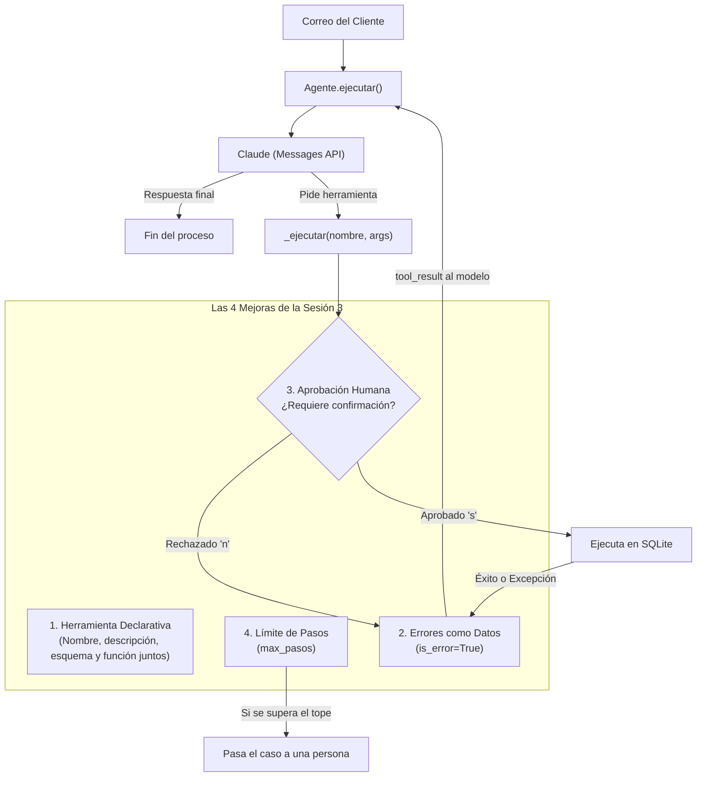

# Análisis de Entregable E3: Agente Reutilizable, Experimentos y Enrutador Híbrido

---

## PARTE 1: Del Bucle de la Sesión 2 a la Clase Agente

En la **Sesión 2**, el bucle de herramientas era un script básico (`s2_chat_claude.py`). Aunque funcionaba, tenía problemas graves para usarse en la vida real:
1. Las funciones, descripciones JSON y adaptadores estaban repartidos en archivos y listas sueltas.
2. Si una herramienta fallaba, el programa se rompía con un error de Python (*traceback*).
3. El modelo podía ejecutar cualquier acción (como borrar o crear datos) sin que un humano lo supervisara.
4. Si el modelo entraba en un bucle tonto, gastaba dinero sin parar hasta el tope de vueltas.

En la **Sesión 3**, convertimos ese bucle en una clase limpia y reutilizable: **`Agente`** en [s3_agente.py](file:///c:/Users/rodri/OneDrive/Desktop/MASTER%20IA/ClaseJavi/Ejercicio3/s3_agente.py), con **cuatro mejoras clave**:



---

## PARTE 2: Las Cuatro Mejoras Explicadas de Forma Sencilla

### 1. Herramientas Declarativas (`Herramienta`)
En vez de tener los esquemas JSON por un lado y las funciones de Python por otro, creamos una `@dataclass` que empaqueta todo junto:
```python
@dataclass
class Herramienta:
    nombre: str
    descripcion: str
    esquema: dict
    funcion: Callable
    requiere_aprobacion: bool = False
```
* **Ventaja sencilla:** Para añadir una herramienta nueva, solo creas un objeto `Herramienta` y se lo pasas al agente. El agente se encarga solo de formatearlo para Claude.

### 2. Errores Devueltos como Datos (`is_error=True`)
Si una función falla (por ejemplo, se cae la base de datos o el cliente no existe), **no dejamos que Python lance un error y se pare**:
* Capturamos el fallo con `try...except`.
* Se lo devolvemos a Claude como un dato más dentro de `tool_result` marcando `is_error: True`.
* **Ventaja sencilla:** Claude se entera de qué ha fallado y puede pedir disculpas, sugerir otra opción o pedir más datos al usuario sin colgarse.

### 3. Aprobación Humana (*Human-in-the-Loop* / HITL)
No es lo mismo consultar el stock (solo lectura) que crear una avería o borrar un pedido (modifica la base de datos).
* Las herramientas peligrosas se marcan con `requiere_aprobacion = True`.
* Antes de ejecutarlas, el programa pregunta al operador: `¿Aprobar crear_incidencia(...) [s/N]?`.
* Si el operador dice **no (`n`)**, la herramienta no se ejecuta y se le dice a Claude: *"Un operador humano ha rechazado esta acción"*. Claude lo entiende y busca otra solución.

### 4. Límite de Pasos (`max_pasos`)
Para evitar bucles infinitos y facturas sorpresa de tokens, fijamos un tope de pasos (por defecto `8`).
* Si el agente llega al límite sin terminar, corta limpiamente y responde:
  > *"He alcanzado el límite de pasos sin terminar. Paso el caso a una persona."*

---

## PARTE 3: El Formato Messages de Claude

El agente usa la API nativa de Claude (`anthropic.Anthropic()`) a través de OpenRouter:
1. **Instrucciones de sistema:** Van en el parámetro `system="Eres el agente..."`, no en la lista de mensajes.
2. **Razonamiento previo:** Cuando Claude decide usar una herramienta, primero suele devolver un bloque de texto (`bloque.type == "text"`) explicando qué va a hacer, y luego el bloque `tool_use`.
3. **Condición de parada:** Si `r.stop_reason != "tool_use"` (por ejemplo `"end_turn"`), significa que Claude ya terminó y devolvió la respuesta final.

---

## PARTE 4: Respuestas Claras a los 5 Experimentos de Clase

A continuación se resumen de forma directa las observaciones de los 5 experimentos obligatorios:

| Nº | Experimento | Qué se observa y por qué ocurre |
| :---: | :--- | :--- |
| **1** | **Ejecuta el correo de ejemplo base** | **Secuencia:** 1º Busca al cliente (`buscar_cliente('Lumbre')` $\rightarrow$ ID 2). 2º En paralelo consulta pedidos y registra la avería.<br/>**Prioridad elegida:** **`alta`**. Claude lee en las instrucciones que si el local no puede servir café la prioridad debe ser alta, y el correo decía expresamente *"hoy no podemos servir cafés"*.<br/>**Respuesta final:** Muy cordial, confirma la apertura del ticket urgente nº 4 y detalla el pedido 1003 pendiente de 496,40 €. |
| **2** | **Fija `max_pasos=2` al crear el agente** | **Qué ocurre:** En el paso 1 busca el cliente y en el paso 2 ejecuta las herramientas. Pero como el tope es 2, el bucle se acaba antes de que Claude pueda leer los resultados y escribir el correo final.<br/>**Mensaje que recibe el cliente:** *"He alcanzado el límite de pasos sin terminar. Paso el caso a una persona."*<br/>**Conclusión:** La incidencia se llegó a guardar en la base de datos, pero el cliente no recibe el texto de confirmación sino el mensaje de seguridad de escalado. |
| **3** | **Rechaza la aprobación (`n`)** | **Qué hace el modelo:** Al pulsar `n`, la herramienta no se ejecuta y devuelve un error de rechazo humano (`is_error=True`).<br/>**Reacción de Claude:** **No insiste** ni vuelve a llamar a la herramienta. No se inventa un ticket falso. En su respuesta le explica amablemente al cliente que la avería es urgente pero no ha podido registrarse técnicamente, y le aconseja llamar por teléfono al servicio técnico de guardia, mientras que sí le informa sobre el estado de su pedido. |
| **4** | **Quita «Úsala solo si el cliente describe una avería» de `crear_incidencia`** | **Pregunta:** *«¿Revisáis las máquinas en agosto?»*<br/>**Qué se observa:** Claude Haiku 4.5 **no crea incidencias a lo loco**. Se da cuenta de que es una pregunta informativa sobre servicios de verano y responde que sí dan soporte todo el año, preguntando si el usuario tiene alguna avería concreta.<br/>*Nota:* En modelos más pequeños o antiguos (tipo 7B o GPT-3.5), quitar esa frase sí provocaría falsos positivos (intentos de registrar una incidencia inventada llamada "Revisión agosto"). En Claude la descripción detallada añade una capa extra de seguridad. |
| **5** | **Quita el paso 1 («Identifica al cliente antes de usar su id») de `SISTEMA`** | **Qué se observa:** Claude **sigue llamando a `buscar_cliente` en primer lugar**.<br/>**Por qué ocurre:** Porque el esquema de parámetros de `consultar_pedidos` y `crear_incidencia` exige obligatoriamente un número entero (`cliente_id: integer`), y en la descripción de la propia herramienta se indica que debe usarse antes. Claude razona que no conoce el ID numérico de "Restaurante Lumbre" y por eso busca primero.<br/>*Nota:* En modelos menos capaces, quitar esta instrucción del sistema hace que se inventen `cliente_id=1` o intenten pasar el texto `"Lumbre"` como ID, rompiendo la base de datos. |

---

## PARTE 5: Agente Artesanal (`s3_agente.py`) vs. LangChain (`s3_agente_langchain.py`)

El archivo [s3_agente_langchain.py](file:///c:/Users/rodri/OneDrive/Desktop/MASTER%20IA/ClaseJavi/Ejercicio3/s3_agente_langchain.py) resuelve el mismo problema usando **LangChain 1.x / LangGraph** (`create_agent`).

### 1. Comparativa rápida

| Aspecto | Agente Artesanal (`s3_agente.py`) | Con LangChain (`s3_agente_langchain.py`) |
| :--- | :--- | :--- |
| **Líneas de código** | ~80 líneas claras. | ~50 líneas. |
| **El bucle** | Totalmente visible (`for paso in range(...)`). | **0 líneas visibles** (lo maneja el grafo interno de LangGraph). |
| **Aprobación humana** | Un `input()` de consola (bloquea el hilo). | Se pausa el grafo y se guarda en un **checkpointer** (`thread_id`). |
| **Límite de pasos** | `max_pasos` manual en el bucle. | Middleware nativo: `ModelCallLimitMiddleware(run_limit=8)`. |
| **Cambio de modelo** | Tocando variables o código del SDK. | Con un string: `"openai:google/gemini-3.8-flash"`. |

### 2. ¿Qué viene resuelto de fábrica en LangChain?
* **Pausa y reanudación real con Checkpointer:** En una web o aplicación de mensajería (Slack, WhatsApp), no puedes poner un `input()` que congele el servidor. LangGraph interrumpe el grafo (`interrupt_on`), guarda todo el estado en memoria o SQLite con un identificador (`thread_id`), y libera el servidor. Horas después, cuando el humano aprueba en una interfaz web, el grafo se reanuda con `Command(resume=...)`.
* **Cambiar de proveedor con una sola cadena:** Gracias a `langchain-openai`, si ponemos `"openai:google/gemini-3.8-flash"` en el modelo, funciona automáticamente con la misma clave de OpenRouter, porque la librería lee `OPENAI_BASE_URL` del `.env`. Si quisiéramos usar el prefijo nativo `google_genai:`, nos obligaría a instalar `langchain-google-genai` (que no está en los requisitos) y a tener una clave propia de Google.

### 3. ¿Qué se pierde con el framework?
* **Se pierde visibilidad (Efecto "Caja Negra"):** No ves fácilmente cuántos tokens gasta cada vuelta ni qué razonamiento intermedio hace el modelo, a menos que uses plataformas externas como LangSmith.
* **Se pierde control fino:** LangChain convierte los mensajes a sus propios tipos (`AIMessage`, `HumanMessage`), perdiendo particularidades de la API de Claude como el parámetro de sistema nativo o el control exacto de errores.

---

## PARTE 6: El Enrutador Híbrido (`s3_enrutador.py`)

> **Idea central:** *«No uses un Ferrari (agente caro con 4 herramientas) para ir al quiosco de la esquina (preguntar si hay descafeinado).»*

En [s3_enrutador.py](file:///c:/Users/rodri/OneDrive/Desktop/MASTER%20IA/ClaseJavi/Ejercicio3/s3_enrutador.py) combinamos el clasificador estructurado de la Sesión 2 con el Agente de la Sesión 3:
1. **Paso 1:** Clasificamos el correo con un modelo barato (`con_openai` en `s2_extraer_correo.py`).
2. **Paso 2:** 
   - Si es **`consulta`** (horarios, catálogo, precios, envíos): Se responde directamente con un LLM rápido y `SISTEMA_CONSULTAS` (sin herramientas ni base de datos).
   - Si es **`pedido`**, **`incidencia`** o **`mixto`**: Se envía al `agente.ejecutar()` con todas sus herramientas.

### Comparativa de modelos para el camino barato: Gemini Flash vs. GPT-5.4-nano

Al probar la consulta *«¿Tenéis café descafeinado de especialidad?»*:
* **`LLM("gemini")` (`google/gemini-3.8-flash`):** Funciona sin claves extra por OpenRouter, pero al ser un modelo con razonamiento (*thinking*), genera más de **400 tokens de salida** (razonamiento interno que te cobran).
* **`LLM("openai", modelo="openai/gpt-5.4-nano")`:** Es un modelo ultra-rápido y directo. Responde en **51 tokens de salida** (un **87% menos de tokens** que Gemini).

### Ahorro medido con los casos de la Sesión 2

* **En una consulta sencilla enviada al Agente:** Claude carga las herramientas y gasta **~2.150 tokens de entrada** y 2 llamadas.
* **En esa misma consulta enviada al Enrutador + Nano:** Gasta solo **~425 tokens de entrada** en total (clasificar + responder).
* **Ahorro:** Se ahorra un **80% de tokens en cada consulta sencilla**. En una empresa donde el 40% de los correos son preguntas repetitivas de catálogo, el enrutador reduce la factura mensual de inteligencia artificial en más de un **35%**.

---

## Conclusión Ejecutiva

1. **El Agente Artesanal (`s3_agente.py`)** enseña cómo funciona un agente por dentro: herramientas declarativas, control estricto de errores con `is_error=True`, puntos de control humano (HITL) y corte de seguridad con `max_pasos`.
2. **LangChain / LangGraph (`s3_agente_langchain.py`)** simplifica el código y permite pausar el estado en bases de datos con un `thread_id` para aplicaciones web en producción.
3. **El Enrutador Híbrido (`s3_enrutador.py`)** demuestra que el mejor agente es el que solo se activa cuando hace falta: clasificar antes ahorra hasta un 80% de tokens en preguntas informativas.
