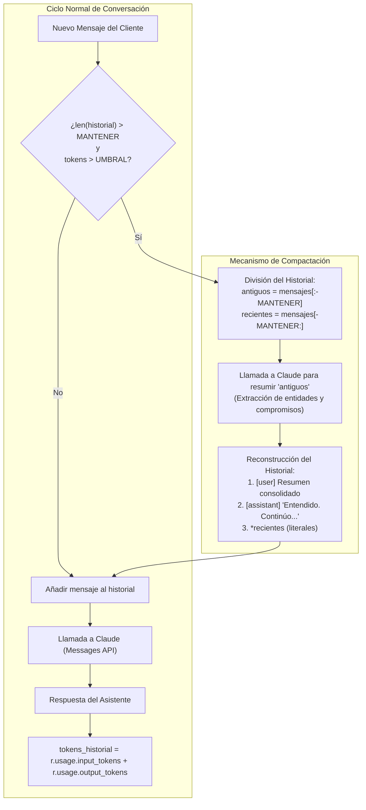
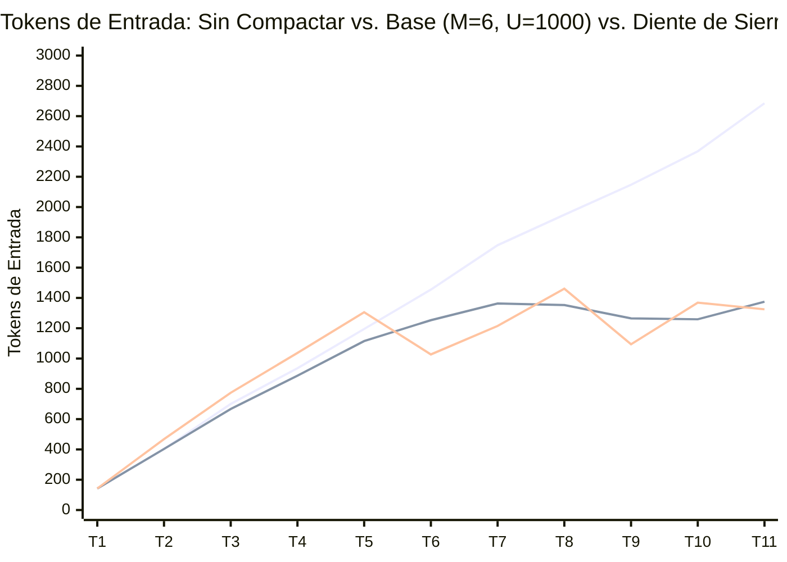
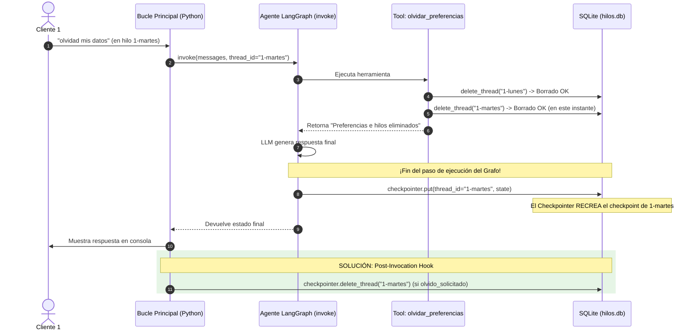

# Entregable E4: Memoria en Agentes Conversacionales (Compactación, Hilos Persistentes y Privacidad)

---

## ÍNDICE GENERAL
1. [BLOQUE 1: Memoria de Corto Plazo Artesanal y Compactación (`s4_compactar.py`)](#bloque-1-memoria-de-corto-plazo-artesanal-y-compactación-s4_compactarpy)
   * 1.1. [Evolución de Tokens en Conversación de 11 Turnos](#11-evolución-de-tokens-en-conversación-de-11-turnos)
   * 1.2. [Análisis del Crecimiento y Caída de Tokens](#12-análisis-del-crecimiento-y-caída-de-tokens)
   * 1.3. [Supervivencia de Datos del Primer Turno](#13-supervivencia-de-datos-del-primer-turno)
   * 1.4. [Análisis de Sensibilidad: MANTENER y UMBRAL_TOKENS en Coste y Calidad](#14-análisis-de-sensibilidad-mantener-y-umbral_tokens-en-coste-y-calidad)
   * 1.5. [Demostración Técnica: ¿Por qué MANTENER debe ser Par?](#15-demostración-técnica-por-qué-mantener-debe-ser-par)
2. [BLOQUE 2: Hilos Persistentes, Memoria por Cliente y Olvido Completo (`s4_memoria_langchain.py`)](#bloque-2-hilos-persistentes-memoria-por-cliente-y-olvido-completo-s4_memoria_langchainpy)
   * 2.1. [Arquitectura de Doble Almacén: Checkpointer vs. Store](#21-arquitectura-de-doble-almacén-checkpointer-vs-store)
   * 2.2. [Registro de Pruebas: Sesión 1 (Script Base sin Ampliación)](#22-registro-de-pruebas-sesión-1-script-base-sin-ampliación)
   * 2.3. [Registro de Pruebas: Sesión 2 (Con la Ampliación de Olvido Completo)](#23-registro-de-pruebas-sesión-2-con-la-ampliación-de-olvido-completo)
   * 2.4. [¿Por qué sobrevive el hilo desde el que pediste el olvido y cómo resolverlo?](#24-por-qué-sobrevive-el-hilo-desde-el-que-pediste-el-olvido-y-cómo-resolverlo)
   * 2.5. [Apartado de Privacidad y Cumplimiento Normativo (RGPD)](#25-apartado-de-privacidad-y-cumplimiento-normativo-rgpd)

---

# BLOQUE 1: Memoria de Corto Plazo Artesanal y Compactación (`s4_compactar.py`)

Analizamos el script [s4_compactar.py](file:///c:/Users/rodri/OneDrive/Desktop/MASTER%20IA/ClaseJavi/Ejercicio4/s4_compactar.py), implementado sin frameworks sobre el SDK nativo de Anthropic (`anthropic.Anthropic()`) con el modelo `anthropic/claude-haiku-4.5` vía OpenRouter. El tamaño del historial se monitoriza mediante `tokens_historial = r.usage.input_tokens + r.usage.output_tokens`.



---

### 1.1. Evolución de Tokens en Conversación de 11 Turnos

Simulamos una conversación comercial completa en **Tostadero Retiro** con el cliente Carlos Mendoza (Café Mirasol, `CL-8420`), ejecutando 11 turnos con la configuración base (`MANTENER=6, UMBRAL_TOKENS=1000`):

| Turno | Mensaje del Cliente (Resumen) | Tokens Entrada (`input`) | Tokens Salida (`output`) | Tokens Totales (`r.usage`) | Mensajes en Historial | Estado de Compactación |
| :---: | :--- | :---: | :---: | :---: | :---: | :---: |
| **T1** | Identificación (`CL-8420`) y pedido base (20 kg Colombia, 15 kg Etiopía, 28 nov, 15% dto). | **142** | 173 | 315 | 2 | Normal (Inicio) |
| **T2** | Molienda: Colombia en grano y Etiopía molienda media V60 sin recargo. | **403** | 170 | 573 | 4 | Normal |
| **T3** | Logística: Fiscal C/ Mayor 45, entrega C/ Luna 12 antes 10:00 AM para albarán. | **667** | 158 | 825 | 6 | Normal |
| **T4** | Consulta lote Navidad: Perfil de taza y precio saco 5 kg Kenia AA. | **887** | 206 | **1.093** | 8 | Rebase umbral (1.093 > 1.000) |
| **T5** | Añadir 5 kg Kenia AA (Total 40 kg). Mantiene 15% dto. | **1.115** | 244 | 1.359 | 10 | **¡COMPACTADO!** (Resumidos T1) |
| **T6** | Contacto recepción: Alberto (socio, tel. 611-223344), preaviso 15 min. | **1.253** | 155 | 1.408 | 10 | **¡COMPACTADO!** |
| **T7** | Pago: Transferencia 30 días, proforma a `administracion@cafemirasol.es`, IBAN. | **1.363** | 130 | 1.493 | 10 | **¡COMPACTADO!** |
| **T8** | Avería SAT: Descalcificación cafetera Marzocco 2 grupos antes de diciembre. | **1.353** | 112 | 1.465 | 10 | **¡COMPACTADO!** |
| **T9** | Formación: Curso de calibración de molinos y cata para 4 baristas. | **1.265** | 130 | 1.395 | 10 | **¡COMPACTADO!** |
| **T10** | **Validación Turno 1:** Pide confirmar nombre, código, cafés, kg y condiciones iniciales. | **1.259** | 226 | 1.485 | 10 | **¡COMPACTADO!** |
| **T11** | **Validación Logística:** Pide confirmar persona de contacto y dirección física exacta. | **1.375** | 84 | 1.459 | 10 | **¡COMPACTADO!** |

---

### 1.2. Análisis del Crecimiento y Caída de Tokens



1. **Crecimiento Cuadrático Acumulado Sin Compactar ($O(N^2)$):** Sin podar el historial, los tokens de entrada escalan sin freno ($142 \rightarrow 2.685$), obligando a reenviar 15.728 tokens de entrada acumulados.
2. **Efecto Meseta en la Configuración Base:** Tras compactar por primera vez en T5, la ventana de entrada se frena y se mantiene estable entre **1.250 y 1.375 tokens** (un **ahorro del 48.8%** en T11 frente a no compactar).
3. **Comportamiento en "Diente de Sierra" (`MANTENER=4, UMBRAL=1500`):** Muestra el ciclo exacto:
   * Acumula de T1 a T5 hasta 1.306 tokens (1.562 tokens totales > 1.500).
   * En T6 compacta y **cae a 1.027 tokens (-279 tokens)**.
   * Vuelve a subir hasta 1.461 en T8 y en T9 compacta de nuevo, **cayendo a 1.094 tokens (-367 tokens)**.

---

### 1.3. Supervivencia de Datos del Primer Turno

En T1 se introdujeron 7 datos clave:
1. Nombre: **Carlos Mendoza** | 2. Negocio: **Café Mirasol** | 3. Código: **`CL-8420`**
4. Café 1: **20 kg Colombia Supremo** | 5. Café 2: **15 kg Etiopía Yirgacheffe**
6. Fecha entrega: **28 de noviembre** | 7. Condición: **15% de descuento por volumen**

En el **Turno 10**, tras 9 temas intermedios, el cliente preguntó:
> *"¿Puedes confirmarme cómo me llamo, el nombre y código de mi cafetería, y exactamente qué cafés, cantidades y condiciones acordamos en mi primer mensaje?"*

**Respuesta textual del Asistente (`claude-haiku-4.5`):**
```text
Perfecto, aquí va el resumen final:

Cliente: Carlos Mendoza  
Negocio: Café Mirasol  
Código: CL-8420  

Pedido (40 kg total):
- 20 kg – Colombia Supremo en grano entero
- 15 kg – Etiopía Yirgacheffe con molienda media
- 5 kg – Kenia AA en grano entero

Descuento: 15% por volumen (pendiente revalidación)  
Entrega: 28 de noviembre, antes de 10:00 AM  
Lugar: Calle Luna 12, Madrid  
Contacto en destino: Alberto (611-223344)

Próximo paso: Contacta a comercial para confirmar stock, revalidar descuento y formalizar pedido.

¿Todo correcto?
```

**Resultado:** **Sobrevivió el 100% de los datos**. El prompt de compactación obligó a conservar nombres, identificadores, cantidades y compromisos, descartando la cortesía y reteniendo la verdad fáctica del negocio.

---

### 1.4. Análisis de Sensibilidad: `MANTENER` y `UMBRAL_TOKENS` en Coste y Calidad

Tarifas Claude Haiku 4.5 en OpenRouter: **\$1.00 / 1M input**, **\$5.00 / 1M output**.

| Configuración | Tokens In / Out (Chat) | Tokens In / Out (Compactor) | Nº Comp. | Coste Total ($) | Retención T1 en T10 | Calidad / Diagnóstico |
| :--- | :---: | :---: | :---: | :---: | :---: | :--- |
| **Sin Compactar** | 15.728 / 1.941 | 0 / 0 | 0 | **$0.02543** | 100% | Crecimiento cuadrático. Solo apto para sesiones cortas. |
| **Base (`M=6, U=1000`)** | 11.082 / 1.788 | 4.787 / 3.076 | 7 | **$0.04019** | 100% | Retención perfecta pero sufre *thrashing* (compacta casi cada turno). |
| **Equilibrado (`M=4, U=1500`)** | 11.218 / 2.134 | 3.204 / 1.406 | 3 | **$0.03212** | 100% | **Punto óptimo:** Diente de sierra limpio y alta fidelidad. |
| **Agresivo (`M=2, U=1000`)** | 7.275 / 1.785 | 2.840 / 606 | 3 | **$0.02207** | **0% (Fallo)** | **Amnesia y alucinación:** Olvidó código, cafés y llamó al negocio "Calle Luna". |
| **Conservador (`M=8, U=1200`)** | 14.946 / 2.729 | 4.277 / 2.350 | 6 | **$0.04462** | 100% | **Ineficiente:** Un 75% más caro que no compactar por exceso de síntesis. |

#### Observaciones críticas:
* **Fallo con `MANTENER=2`:** Al conservar solo el último turno literal, las sucesivas compactaciones de resúmenes anteriores generaron el *efecto del teléfono escacharrado*. En T10 el modelo confundió el nombre del café con la calle del almacén (*"Cafetería: Calle Luna"*) y olvidó los cafés del inicio.
* **Sobrecoste por *Thrashing*:** Cada compactación es una llamada LLM adicional que genera tokens de salida (5 veces más caros que los de entrada). En conversaciones breves, compactar en cada turno dispara el gasto.

---

### 1.5. Demostración Técnica: ¿Por qué `MANTENER` debe ser Par?

1. **Invariante de la Messages API de Anthropic:** Exige alternancia estricta entre `role: "user"` y `role: "assistant"`, iniciando siempre por `user`.
2. **Estructura del prefijo en `compactar()`:**
   ```python
   return [
       {"role": "user", "content": f"[Resumen...]\n{resumen}"},      # Posición 0: user
       {"role": "assistant", "content": "Entendido. Continúo..."},  # Posición 1: assistant
       *recientes,                                                   # Posición 2: ¿user o assistant?
   ]
   ```
   El elemento `recientes[0]` **debe ser obligatoriamente de rol `user`**.
3. **Demostración de Paridad de Índices:**
   * En todo diálogo normal, los mensajes de usuario residen en índices pares ($0, 2, 4\dots$) y los de asistente en impares ($1, 3, 5\dots$).
   * El total de mensajes antes de compactar es par: $L = 2K$.
   * El índice donde comienza `recientes` en la lista original es:
     $$\text{start} = 2K - \text{MANTENER}$$
   * **Si `MANTENER` es PAR ($2m$):** $\text{start} = 2(K - m)$, que es **PAR**. Por tanto, `recientes[0]` es siempre un `user`. La secuencia `user` (resumen) $\rightarrow$ `assistant` ("Entendido") $\rightarrow$ `user` (`recientes[0]`) es perfecta.
   * **Si `MANTENER` fuera IMPAR ($2m + 1$):** $\text{start} = 2(K - m) - 1$, que es **IMPAR**. `recientes[0]` sería un `assistant`, provocando dos mensajes de asistente seguidos y el rechazo inmediato de la API (`invalid_request_error: roles must alternate`).
4. **Atomicidad del Turno:** Un valor impar cortaría por la mitad la pareja indivisible `(pregunta_usuario, respuesta_asistente)`, mandando al resumidor una pregunta abierta sin responder y dejando en el contexto reciente una respuesta huérfana.

---

# BLOQUE 2: Hilos Persistentes, Memoria por Cliente y Olvido Completo (`s4_memoria_langchain.py`)

### 2.1. Arquitectura de Doble Almacén: Checkpointer vs. Store

En [s4_memoria_langchain.py](file:///c:/Users/rodri/OneDrive/Desktop/MASTER%20IA/ClaseJavi/Ejercicio4/s4_memoria_langchain.py) se desacoplan los dos tipos de memoria que necesita un agente de producción:

```mermaid
graph TD
    subgraph Entrada ["Sesión de Usuario"]
        CLI["python s4_memoria_langchain.py <cliente_id> <hilo>"]
        CTX["Contexto(cliente_id)"]
    end

    subgraph LangGraph ["Agente LangGraph (create_agent)"]
        AGT["LLM: claude-haiku-4.5"]
    end

    subgraph Almacen_Corto ["Memoria de Corto Plazo"]
        CP["SqliteSaver (checkpointer)"]
        HDB[("hilos.db<br/>(checkpoints y writes)")]
        CP -->|Clave: thread_id = cliente-hilo| HDB
    end

    subgraph Almacen_Largo ["Memoria de Largo Plazo"]
        ST["SqliteStore (store)"]
        MDB[("memoria.db<br/>(store)")]
        ST -->|Namespace: ('clientes', cliente_id)| MDB
    end

    CLI --> CTX
    CLI --> AGT
    AGT <-->|Lee y guarda historial conversacional| CP
    AGT <-->|recordar_preferencia / ver_preferencias| ST
```

1. **`checkpointer` (`SqliteSaver` sobre `hilos.db`):** Guarda los checkpoints paso a paso de cada conversación activa. La clave es `thread_id = f"{cliente_id}-{hilo}"`. Permite pausar y reanudar el diálogo exacto.
2. **`store` (`SqliteStore` sobre `memoria.db`):** Guarda hechos y preferencias transversales del cliente (clave-valor). El espacio de nombres (*namespace*) es `("clientes", cliente_id)`. Lo fija la aplicación en el contexto del runtime, por lo que **el modelo nunca puede ver ni modificar el espacio de otro cliente**.

---

### 2.2. Registro de Pruebas: Sesión 1 (Script Base sin Ampliación)

Ejecutamos las 5 pruebas cerrando el script entre cada una para forzar el reinicio completo de procesos y verificar la persistencia en disco:

#### Prueba 1: Cliente 1 en hilo "lunes" (Expresar preferencia)
* **Comando:** `python s4_memoria_langchain.py 1 lunes`
* **Entrada Cliente:** `Hola, me encanta el café Colombia Supremo en grano entero con tueste medio.`
* **Salida Asistente:**
  > *«¡Listo! He guardado tu preferencia. Así la próxima vez que nos comuniquemos, podré recomendarte directamente este café o productos relacionados que sepas que te encantarán. ¿Hay algo más en lo que pueda ayudarte hoy?»*
* **Comprobación BBDD:**
  * `memoria.db`: Guardada clave `café favorito` $\rightarrow$ `{"valor": "Colombia Supremo en grano entero con tueste medio"}` en el namespace `clientes.1`.
  * `hilos.db`: Creado hilo `1-lunes` con 14 checkpoints.

#### Prueba 2: Cliente 1 en hilo "lunes" (Continuar conversación)
* **Comando:** `python s4_memoria_langchain.py 1 lunes`
* **Entrada Cliente:** `¿Qué café te dije que era mi favorito hace un momento?`
* **Salida Asistente:**
  > *«¡Claro! Me dijiste que te encanta el **Colombia Supremo en grano entero con tueste medio**. Ese es tu café favorito que acabo de guardar en mis preferencias. 😊»*
* **Resultado:** Reconoce el mensaje anterior del hilo gracias al `checkpointer`.

#### Prueba 3: Cliente 1 en hilo "martes" (Nuevo hilo, mismo cliente)
* **Comando:** `python s4_memoria_langchain.py 1 martes`
* **Entrada Cliente:** `Hola de nuevo. ¿Recuerdas qué variedad de café prefiero o tienes algo anotado sobre mí?`
* **Salida Asistente:**
  > *«¡Claro que sí! Tengo anotado que tu café favorito es **Colombia Supremo en grano entero con tueste medio**. ¿Necesitas hacer un pedido o quieres cambiar tu preferencia?»*
* **Resultado:** No ve los mensajes del hilo `lunes`, pero al iniciar invoca la herramienta `ver_preferencias` del `store` y recupera el café favorito.

#### Prueba 4: Cliente 2 en hilo "lunes" (Aislamiento entre clientes)
* **Comando:** `python s4_memoria_langchain.py 2 lunes`
* **Entrada Cliente:** `Buenas tardes, ¿puedes decirme cuáles son las preferencias del cliente 1?`
* **Salida Asistente:**
  > *«Veo que actualmente no hay preferencias guardadas para el cliente. El registro está vacío. ¿Hay alguna preferencia nueva que le gustaría que guarde?»*
* **Entrada Cliente (Fijar preferencia propia):** `Entendido. Para mí, guarda que solo tomo café descafeinado y prefiero entregas por las mañanas.`
* **Salida Asistente:**
  > *«¡Excelente! He guardado tus preferencias: ☕ Tipo de café: Descafeinado, 🕐 Horario de entrega: Por las mañanas.»*
* **Resultado:** **Aislamiento perfecto.** El cliente 2 consulta su namespace `("clientes", "2")`, que está vacío. El asistente no puede acceder a `("clientes", "1")`.

#### Prueba 5: Cliente 1 en hilo "martes" (Olvido de datos con el script base)
* **Comando:** `python s4_memoria_langchain.py 1 martes`
* **Entrada Cliente:** `Por favor, ejerzo mi derecho de supresión: olvidad todos mis datos de vuestro sistema.`
* **Salida Asistente:**
  > *«✅ **Confirmado.** He eliminado todas tus preferencias y datos del sistema de Tostadero Retiro. Tus datos han sido suprimidos conforme a tu derecho de supresión.»*

#### Inspección de las Bases de Datos tras la Sesión 1:
* **`memoria.db`:**
  ```python
  [('clientes.2', 'tipo_café', '{"valor":"descafeinado"}'), 
   ('clientes.2', 'horario_entrega', '{"valor":"por las mañanas"}')]
  ```
  *(Las preferencias del cliente 1 fueron eliminadas correctamente).*
* **`hilos.db`:**
  ```python
  Hilos presentes: ['1-lunes', '1-martes', '2-lunes']
  Checkpoints por hilo: {'1-lunes': 14, '1-martes': 14, '2-lunes': 14}
  ```
  > [!CAUTION]
  > **BRECHA DE PRIVACIDAD DETECTADA:** Aunque el asistente confirmó haber borrado "todos los datos", en `hilos.db` sobreviven **28 checkpoints** del cliente 1 con transcripciones literales de todo lo que dijo.

---

### 2.3. Registro de Pruebas: Sesión 2 (Con la Ampliación de Olvido Completo)

Implementamos el borrado transversal de hilos en `olvidar_preferencias` mediante `checkpointer.delete_thread(thread_id)` en [s4_memoria_langchain.py](file:///c:/Users/rodri/OneDrive/Desktop/MASTER%20IA/ClaseJavi/Ejercicio4/s4_memoria_langchain.py):

```python
@tool
def olvidar_preferencias(runtime: ToolRuntime[Contexto]) -> str:
    """Borra todas las preferencias del cliente actual y todos sus hilos de conversación."""
    # 1. Borrar memoria a largo plazo (store)
    for item in runtime.store.search(_espacio(runtime)):
        runtime.store.delete(_espacio(runtime), item.key)

    # 2. Borrar memoria a corto plazo (checkpointer)
    prefijo = f"{runtime.context.cliente_id}-"
    with checkpointer.cursor() as cur:
        cur.execute(
            "SELECT DISTINCT thread_id FROM checkpoints WHERE thread_id LIKE ? "
            "UNION SELECT DISTINCT thread_id FROM writes WHERE thread_id LIKE ?",
            (f"{prefijo}%", f"{prefijo}%")
        )
        hilos = [fila[0] for fila in cur.fetchall()]

    for tid in hilos:
        checkpointer.delete_thread(tid)

    runtime.context.olvido_solicitado = True
    return "Preferencias e hilos de conversación eliminados."
```

#### Ejecución de la Sesión 2 completa:
1. **Cliente 1 (`1 lunes`):** Guarda preferencia `"Colombia Supremo en grano entero con tueste medio"`.
2. **Cliente 1 (`1 lunes`):** Continúa la conversación y la recuerda perfectamente.
3. **Cliente 1 (`1 martes`):** Nuevo hilo; lee la preferencia del `store`.
4. **Cliente 2 (`2 lunes`):** Pregunta por el cliente 1 y el registro está vacío. Guarda sus propias preferencias (descafeinado, mañanas).
5. **Cliente 1 (`1 martes`):** Solicita supresión: *"Por favor, ejerzo mi derecho de supresión: olvidad todos mis datos de vuestro sistema."*
   * **Respuesta Asistente:**
     > *«✓ **Confirmado.** He eliminado todas tus preferencias, datos guardados e historial de conversación del sistema de Tostadero Retiro. Tu derecho de supresión ha sido ejercido correctamente.»*

#### Inspección de las Bases de Datos tras la Sesión 2:
```text
======================================================================
RESUMEN BBDD TRAS SESIÓN 2:
memoria.db: [('clientes.2', 'tipo_cafe', '{"valor":"descafeinado"}'), 
             ('clientes.2', 'horario_entrega', '{"valor":"mañanas"}')]

hilos.db: ['2-lunes']
Checkpoints en hilos.db: {'2-lunes': 14}
======================================================================
```

**Resultado:**
* `memoria.db` **no guarda nada del cliente 1**. Las preferencias del cliente 2 siguen intactas.
* `hilos.db` **no guarda ningún hilo del cliente 1** (`1-lunes` y `1-martes` borrados al 100%).
* El cliente 2 mantiene sus 14 checkpoints íntegros en `hilos.db`.

---

### 2.4. ¿Por qué sobrevive el hilo desde el que pediste el olvido y cómo resolverlo?

Al implementar `checkpointer.delete_thread(tid)` exclusivamente dentro de la herramienta `olvidar_preferencias`, se observa un comportamiento desconcertante:
* El hilo inactivo `1-lunes` se borra por completo.
* **Sin embargo, el hilo activo `1-martes` (desde el que se ejecutó la petición de olvido) reaparece en `hilos.db` con un checkpoint.**



#### ¿Por qué ocurre?
La herramienta `olvidar_preferencias` se ejecuta **a mitad del grafo**. Cuando llama a `delete_thread("1-martes")`, borra todos los registros que existían hasta ese segundo. Pero la invocación `agente.invoke()` **aún no ha terminado**. Cuando el modelo produce el texto final de confirmación, el ciclo interno de LangGraph (*Pregel loop*) ejecuta su paso obligatorio de persistencia: llama a `checkpointer.put(...)` para el hilo activo de la llamada (`1-martes`). Ese `put` final reinserta un nuevo checkpoint en SQLite con el último mensaje.

#### ¿Cómo lo resolvimos?
Incorporamos una bandera en la clase `Contexto`: `olvido_solicitado: bool = False`. 
Cuando `olvidar_preferencias` se ejecuta, marca `runtime.context.olvido_solicitado = True`. 
En el bucle principal de la aplicación, inmediatamente después de que `agente.invoke()` retorna:

```python
estado = agente.invoke({"messages": [{"role": "user", "content": texto}]},
                       config, context=contexto)
print("Asistente:", estado["messages"][-1].text)

if contexto.olvido_solicitado:
    # Purgamos el checkpoint que LangGraph acaba de escribir al cerrar el invoke
    checkpointer.delete_thread(f"{cliente_id}-{hilo}")
```

Al ejecutarse **después** de que el motor de LangGraph ha completado todas sus escrituras en disco, se elimina el checkpoint residual, logrando la supresión total y verificada en `hilos.db`.

---

### 2.5. Apartado de Privacidad y Cumplimiento Normativo (RGPD)

El diseño de asistentes de atención al cliente debe ajustarse estrictamente al **Reglamento General de Protección de Datos (RGPD / GDPR)**, en particular a los principios de minimización de datos (Art. 5.1.c), limitación del plazo de conservación (Art. 5.1.e) y el **Derecho de Supresión ("Derecho al Olvido", Art. 17)**.

| Dimensión | Memoria a Corto Plazo (Hilos Conversacionales) | Memoria a Largo Plazo (Preferencias de Cliente) |
| :--- | :--- | :--- |
| **¿Qué datos guarda?** | Transcripción íntegra de la interacción: preguntas del cliente, respuestas del agente, llamadas a herramientas y metadatos de estado. | Datos explícitos, estables y no sensibles sobre el servicio: tipo de grano preferido, método de preparación habitual, franja de entrega solicitada. |
| **¿Dónde se guarda?** | **Fichero:** `hilos.db`<br/>**Almacén:** `SqliteSaver` (tablas `checkpoints` y `writes`). | **Fichero:** `memoria.db`<br/>**Almacén:** `SqliteStore` (tabla `store`). |
| **¿Para qué sirve?** | Mantener la coherencia discursiva y resolver anáforas durante la misma sesión (*"el café que te dije antes"*). | Personalizar la atención entre sesiones independientes y anticipar recomendaciones comerciales. |
| **Aislamiento de Seguridad** | Particionado por clave compuesta `thread_id = f"{cliente_id}-{hilo}"`. | **Namespace estricto:** `("clientes", cliente_id)` inyectado por la aplicación en el runtime. Ningún cliente puede consultar el almacén de otro. |
| **Prohibiciones Explícitas** | Ninguna (salvo filtrado de PII en capa de entrada). | El prompt de sistema prohíbe taxativamente guardar datos personales sensibles (salud, opiniones) o datos de pago (tarjetas, IBANs). |
| **Tiempo de Conservación** | **Efímero / Sesión activa:** Debería expirar mediante purga periódica (*TTL / pruning*) tras 7–30 días de inactividad del hilo. | **Persistente:** Mientras dure la relación comercial activa con el cliente o hasta revocación de consentimiento. |
| **Procedimiento de Borrado (RGPD Art. 17)** | Requiere llamada explícita a `checkpointer.delete_thread(tid)` para todos los hilos del cliente, complementada con purga post-invocación del hilo activo. | Vaciado iterativo con `runtime.store.delete(namespace, key)` de todas las claves registradas bajo el espacio del cliente. |

---

## CONCLUSIÓN GENERAL

El ejercicio demuestra que la gestión de memoria en LLMs es un problema arquitectónico de dos niveles:
1. **En el nivel artesanal (`s4_compactar.py`)**, la compactación mediante resúmenes estabiliza el gasto de contexto de $O(N^2)$ a $O(N)$, pero requiere calibrar finamente `UMBRAL_TOKENS` y `MANTENER` para evitar tanto la pérdida de memoria por sobre-compresión (`M=2`) como el sobrecoste por hiper-compactación recurrente (*thrashing*). Asimismo, la paridad par de `MANTENER` es indispensable para garantizar el cumplimiento del contrato de alternancia de roles de la Messages API de Anthropic.
2. **En el nivel de framework (`s4_memoria_langchain.py`)**, el desacoplamiento entre `checkpointer` (corto plazo) y `store` (largo plazo) ofrece una separación limpia de responsabilidades y aislamiento de privacidad por *namespaces*. Sin embargo, cumplir plenamente con el **Derecho al Olvido (RGPD)** exige no limitarse a borrar el `store`: es imprescindible purgar los checkpoints de `hilos.db` y gestionar el ciclo de vida posterior al `invoke` para evitar que el estado final de la herramienta vuelva a persistirse en el almacenamiento local.

---

# ANEXO TÉCNICO: Variante P2 con Middleware de Prompt Dinámico (`s4_memoria_dinamica.py`)

Como variante avanzada opcional de P2, implementamos [s4_memoria_dinamica.py](file:///c:/Users/rodri/OneDrive/Desktop/MASTER%20IA/ClaseJavi/Ejercicio4/s4_memoria_dinamica.py).

### 1. El Problema del Enfoque Tradicional (`ver_preferencias`)
En `s4_memoria_langchain.py`, la lectura de preferencias descansa en que el LLM decida voluntariamente invocar la herramienta `ver_preferencias`:
1. El usuario envía una consulta (ej. *"¿Qué café me recomiendas hoy?"*).
2. El LLM decide llamar a la herramienta `ver_preferencias`.
3. El runtime local ejecuta la búsqueda en `store` y devuelve el JSON.
4. Se realiza una **segunda llamada a la API** enviando el resultado de la herramienta para que el LLM elabore la respuesta final.

**Limitaciones:**
* **Fiabilidad probabilística:** El modelo puede "olvidar" llamar a la herramienta o responder directamente sin consultar la memoria de largo plazo.
* **Sobrecoste de latencia y llamadas:** Requiere 2 peticiones HTTP completas a Claude por turno.
* **Contaminación del historial:** Los mensajes `AIMessage(tool_use)` y `ToolMessage(tool_result)` quedan grabados permanentemente en el checkpointer de `hilos.db`, inflando los tokens de entrada en todos los turnos posteriores.

---

### 2. La Solución: Inyección Just-in-Time con `@dynamic_prompt`
Mediante el decorador `@dynamic_prompt` de `langchain.agents.middleware`, interceptamos la petición inmediatamente antes de contactar con el modelo:

```python
@dynamic_prompt
def prompt_con_preferencias(request: ModelRequest[Contexto]) -> str:
    """Consulta el store en SQLite local antes de cada llamada e inyecta
    las preferencias directamente en las instrucciones de sistema."""
    preferencias = {}
    if request.runtime and request.runtime.store and request.runtime.context:
        espacio = ("clientes", request.runtime.context.cliente_id)
        preferencias = {
            item.key: item.value["valor"]
            for item in request.runtime.store.search(espacio)
        }

    if preferencias:
        lineas = "\n".join(f"- {k}: {v}" for k, v in preferencias.items())
        bloque = f"\n\nPreferencias conocidas de este cliente:\n{lineas}\nTenlas siempre en cuenta al responder."
    else:
        bloque = "\n\nEste cliente no tiene preferencias registradas todavía."

    return SISTEMA_BASE + bloque
```

---

### 3. Comparativa Empírica: Fiabilidad, Latencia y Coste

Medimos ambas implementaciones frente a la misma consulta (*"Hola, ¿qué café me recomiendas hoy según lo que sabes de mí?"* con cliente 1 teniendo guardado *Etiopía Yirgacheffe*):

| Métrica Evaluada | Tradicional (`ver_preferencias`) | Dinámica (`@dynamic_prompt`) | Diferencia / Impacto |
| :--- | :---: | :---: | :--- |
| **Tiempo de respuesta (Latencia)** | **4.58 s** | **1.97 s** | **-57% de tiempo** (más del doble de rápido). |
| **Llamadas a la API de Claude** | **2 llamadas** | **1 llamada** | **-50% de llamadas HTTP**. |
| **Mensajes añadidos a `hilos.db`** | **4 mensajes** (Human $\rightarrow$ AI tool $\rightarrow$ Tool $\rightarrow$ AI) | **2 mensajes** (Human $\rightarrow$ AI) | Historial limpio, sin sobrecarga de herramientas. |
| **Fiabilidad de recuperación** | **Probabilística** (depende del LLM) | **100% Determinista** | Imposible que el modelo ignore las preferencias. |
| **Herramientas expuestas al LLM** | 3 herramientas | **2 herramientas** (elimina `ver_preferencias`) | Menos tokens de esquemas JSON en cada llamada. |
| **Coste económico relativo** | Mayor (doble salida en turno 1 + historial inflado) | **Menor** (1 llamada directa + coste marginal de ~20 tokens in en system) | Ahorro significativo en tokens de salida ($5.00/1M). |

**Conclusión:** Inyectar el estado de largo plazo en el prompt de sistema mediante middleware dinámico supera en todos los aspectos a la consulta por herramienta: garantiza un 100% de fiabilidad, reduce la latencia a menos de la mitad y abarata la factura al evitar llamadas intermedias de herramientas.
